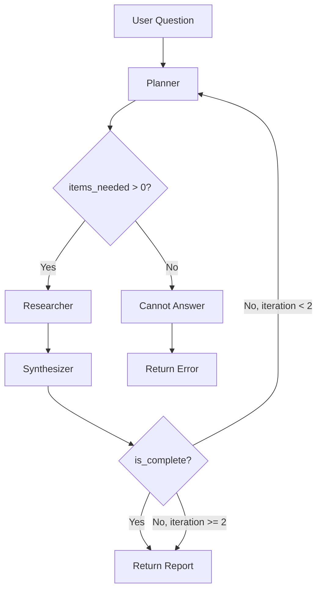

# 10-K Filing Agentic System - Planning Document

## Problem Statement

**Target User:** Analysts at a 500-person professional services firm (law firms, investment banks, consulting firms)

**Pain Point:** Analysts spend ~4 hours/day on early-stage research — pulling background on companies, regulatory filings, and market context — before any deliverable work begins.

**Solution:** A multi-agent research system that takes questions about SEC 10-K filings, decomposes them into sub-tasks, fetches relevant filing sections via MCP, and returns a grounded, citation-backed report.

**Example Questions:**
- "What are Apple's main risk factors?"
- "Compare Microsoft and Google's revenue breakdown"
- "Has Tesla's debt increased year over year?"
- "What are Amazon's key business segments?"

---

## Architecture

```
┌─────────────────────────────────────────────────────────────┐
│                        User Question                         │
│         "What are Apple's main financial risks?"            │
└─────────────────────────────────────────────────────────────┘
                              │
                              ▼
┌─────────────────────────────────────────────────────────────┐
│                         PLANNER                              │
│  - Parses question                                          │
│  - Identifies company (ticker/name)                         │
│  - Determines which 10-K items are needed                   │
│  - Outputs structured plan                                  │
└─────────────────────────────────────────────────────────────┘
                              │
                    ┌─────────┴─────────┐
                    │ Conditional Edge  │
                    │ items_needed > 0? │
                    └─────────┬─────────┘
                         yes/ \no
                           /   \
                          ▼     ▼
┌──────────────────────────┐   ┌─────────────────┐
│       RESEARCHER         │   │  CANNOT_ANSWER  │
│  - Calls SEC EDGAR MCP   │   │  Return error   │
│  - Fetches needed items  │   │  with reason    │
│  - Returns raw data      │   └─────────────────┘
└──────────────────────────┘
                │
                ▼
┌─────────────────────────────────────────────────────────────┐
│                       SYNTHESIZER                            │
│  - Combines raw data into structured answer                 │
│  - Adds citations (SEC filing URLs)                         │
│  - Checks if answer is complete                             │
└─────────────────────────────────────────────────────────────┘
                │
       ┌────────┴────────┐
       │ is_complete?    │
       └────────┬────────┘
           yes/ \no (needs more data)
             /   \
            ▼     ▼
     ┌──────────┐  ┌──────────────┐
     │  DONE    │  │ Back to      │
     │  Return  │  │ PLANNER      │
     │  Report  │  │ (max 2 loops)│
     └──────────┘  └──────────────┘
```

### Mermaid Diagram



---

## State Definition

```python
from typing import TypedDict, Optional

class ResearchState(TypedDict):
    # Input
    question: str                      # User's original question
    
    # Planner outputs
    company: str                       # Extracted company ticker (AAPL, MSFT)
    company_name: str                  # Full company name
    items_needed: list[str]            # ["1A", "7", "8"]
    research_questions: list[str]      # Sub-questions to answer
    
    # Researcher outputs
    raw_data: dict[str, str]           # {"1A": "risk factors text...", "7": "MD&A text..."}
    filing_info: dict                  # {accession_number, filing_date, url}
    
    # Synthesizer outputs
    report: dict                       # Final structured report
    citations: list[dict]              # [{source, url, item, excerpt}]
    is_complete: bool                  # Whether answer is complete
    missing_info: list[str]            # What's still needed (if incomplete)
    
    # Control flow
    iteration: int                     # Track loops (max 2)
    error: Optional[str]               # Any errors encountered
```

---

## 10-K Item Reference

| Item | Content | When to Extract |
|------|---------|-----------------|
| **Item 1** | Business Description | "What does X do?", business model questions |
| **Item 1A** | Risk Factors | Risk-related questions |
| **Item 1C** | Cybersecurity | Security/cyber questions |
| **Item 3** | Legal Proceedings | Legal/litigation questions |
| **Item 7** | MD&A | Revenue, growth, strategy, financial analysis |
| **Item 7A** | Market Risk | Interest rate, currency risk |
| **Item 8** | Financial Statements | Specific numbers, balance sheet, income |
| **Item 10** | Directors & Officers | Governance, leadership questions |
| **Item 11** | Executive Compensation | Compensation questions |

---

## MCP Integration

### MCP Server
Using: **sec-edgar-mcp** (already cloned to `/Users/raghavraahul/Downloads/sec-edgar-mcp`)

### Running the MCP Server
```bash
docker run -i --rm \
  -e SEC_EDGAR_USER_AGENT="Your Name (your@email.com)" \
  stefanoamorelli/sec-edgar-mcp:latest
```

### Available Tools (22 Total)

#### Company Tools
| Tool | Purpose | Args |
|------|---------|------|
| `get_cik_by_ticker` | Convert ticker to CIK | `ticker` |
| `get_company_info` | Company details (name, SIC, exchange) | `identifier` |
| `search_companies` | Search companies by name | `query`, `limit` |
| `get_company_facts` | All XBRL facts for a company | `identifier` |

#### Filing Tools
| Tool | Purpose | Args |
|------|---------|------|
| `get_recent_filings` | List recent filings | `identifier`, `form_type`, `days`, `limit` |
| `get_filing_content` | Full filing text (with paging) | `identifier`, `accession_number`, `offset`, `max_chars` |
| `get_filing_sections` | Extract sections (business, risk_factors, mda) | `identifier`, `accession_number`, `form_type` |
| `analyze_8k` | Analyze 8-K events | `identifier`, `accession_number` |

#### Financial Tools (Most Useful!)
| Tool | Purpose | Args |
|------|---------|------|
| `get_financials` | Income, balance sheet, cash flow | `identifier`, `statement_type`, `form_type` |
| `get_segment_data` | Revenue by segment/geography | `identifier`, `segment_type` |
| `get_key_metrics` | Specific XBRL metrics | `identifier`, `metrics` |
| `compare_periods` | YoY comparison with growth rates | `identifier`, `metric`, `start_year`, `end_year` |
| `discover_company_metrics` | Find available metrics | `identifier`, `search_term` |
| `get_xbrl_concepts` | Extract specific XBRL concepts | `identifier`, `accession_number`, `concepts`, `form_type` |
| `discover_xbrl_concepts` | Explore available XBRL data | `identifier`, `accession_number`, `form_type`, `namespace_filter` |

#### Insider Trading Tools
| Tool | Purpose | Args |
|------|---------|------|
| `get_insider_transactions` | Form 3/4/5 transactions | `identifier`, `form_types`, `days`, `limit` |
| `get_insider_summary` | Summary of insider activity | `identifier`, `days` |
| `get_form4_details` | Detailed Form 4 data | `identifier`, `accession_number` |
| `analyze_form4_transactions` | Detailed transaction analysis | `identifier`, `days`, `limit` |
| `analyze_insider_sentiment` | Trading pattern analysis | `identifier`, `months` |

#### Utility Tools
| Tool | Purpose | Args |
|------|---------|------|
| `get_recommended_tools` | Suggests tools for a form type | `form_type` |

### Key Tools for Our Use Case

For 10-K analysis, the most relevant tools are:

| Question Type | Tools to Use |
|--------------|--------------|
| Risk factors | `get_filing_sections` → extracts `risk_factors` |
| Financial numbers | `get_financials`, `get_key_metrics` |
| Revenue breakdown | `get_segment_data` |
| YoY comparison | `compare_periods` |
| Business description | `get_filing_sections` → extracts `business` |
| MD&A analysis | `get_filing_sections` → extracts `mda` |

### Tool Call Flow
```
1. Researcher calls: get_recent_filings(identifier="AAPL", form_type="10-K", limit=1)
   → Returns: accession_number, filing_date, url

2. For text sections:
   Researcher calls: get_filing_sections(identifier="AAPL", accession_number="...", form_type="10-K")
   → Returns: {risk_factors: "...", mda: "...", business: "..."}

3. For financial data:
   Researcher calls: get_financials(identifier="AAPL", statement_type="all")
   → Returns: income statement, balance sheet, cash flow with exact XBRL values

4. For YoY comparison:
   Researcher calls: compare_periods(identifier="AAPL", metric="Revenues", start_year=2023, end_year=2024)
   → Returns: year-over-year comparison with growth rates
```

---

## Conditional Edges

### Edge 1: After Planner
```python
def route_after_planner(state: ResearchState) -> str:
    if not state["items_needed"] or len(state["items_needed"]) == 0:
        return "cannot_answer"
    return "researcher"
```

### Edge 2: After Synthesizer
```python
def route_after_synthesizer(state: ResearchState) -> str:
    if state["is_complete"]:
        return "done"
    if state["iteration"] >= 2:
        return "done"  # Max iterations reached, return partial answer
    return "planner"  # Loop back for more data
```

---

## FastAPI Endpoints

| Endpoint | Method | Purpose |
|----------|--------|---------|
| `/research` | POST | Submit research question, returns job_id |
| `/jobs/{job_id}` | GET | Check job status, get result |
| `/healthz` | GET | Health check |

### Request/Response Models

```python
# Request
class ResearchRequest(BaseModel):
    question: str
    company: Optional[str] = None  # Optional hint

# Response (job created)
class JobCreated(BaseModel):
    job_id: str
    status: str = "queued"

# Response (job status)
class JobStatus(BaseModel):
    job_id: str
    status: str  # queued | running | done | failed
    result: Optional[ResearchReport] = None
    error: Optional[str] = None

# Final report
class ResearchReport(BaseModel):
    question: str
    company: str
    summary: str
    findings: list[Finding]
    citations: list[Citation]
```

---

## Golden Task Set (5 Questions)

| # | Question | Expected Items | Verification |
|---|----------|---------------|--------------|
| 1 | "What are Apple's main risk factors?" | 1A | Check if risks match actual 10-K Item 1A |
| 2 | "What is Microsoft's cloud revenue?" | 7, 8 | Verify revenue number matches filing |
| 3 | "Describe Tesla's business model" | 1 | Check if description matches Item 1 |
| 4 | "What legal proceedings is Amazon involved in?" | 3 | Verify legal items match Item 3 |
| 5 | "Compare Apple's revenue YoY" | 7, 8 | Verify numbers match MD&A |

### Evaluation Criteria
- **Citation accuracy:** Does citation URL point to correct filing?
- **Factual accuracy:** Do extracted facts match the actual filing?
- **Completeness:** Did it answer all parts of the question?
- **Item coverage:** Did it fetch the right items?

---

## Project Structure

```
10k_filing_agentic_system/
├── README.md                    # Project overview, setup, usage
├── PLANNING.md                  # This file
├── CLAUDE_CODE_NOTES.md         # AI assistance documentation
├── Dockerfile                   # Container for FastAPI
├── docker-compose.yml           # Optional: orchestrate with MCP server
├── pyproject.toml               # Dependencies
├── .env.example                 # Required env vars
│
├── app/
│   ├── __init__.py
│   ├── main.py                  # FastAPI app
│   ├── models.py                # Pydantic schemas
│   └── config.py                # Settings
│
├── agents/
│   ├── __init__.py
│   ├── state.py                 # ResearchState definition
│   ├── planner.py               # Planner agent
│   ├── researcher.py            # Researcher agent (MCP calls)
│   ├── synthesizer.py           # Synthesizer agent
│   └── graph.py                 # LangGraph StateGraph
│
├── tools/
│   ├── __init__.py
│   └── mcp_client.py            # MCP client wrapper
│
├── eval/
│   ├── golden_tasks.json        # 5 test questions
│   └── run_eval.py              # Evaluation script
│
└── traces/
    └── example_trace.png        # LangSmith screenshot
```

---

## Requirements Checklist

| # | Requirement | Status |
|---|-------------|--------|
| 1 | LangGraph with 3+ agents | ✅ Planner, Researcher, Synthesizer |
| 2 | StateGraph with conditional edge | ✅ 2 conditional edges |
| 3 | At least one MCP-backed tool | ✅ sec-edgar-mcp |
| 4 | FastAPI service | ✅ POST /research, GET /jobs, GET /healthz |
| 5 | Pydantic schemas | ✅ Request/response models |
| 6 | Async endpoint | ✅ /research is async |
| 7 | LangSmith tracing | ✅ Configured via env vars |
| 8 | Golden task set (5+) | ✅ 5 SEC filing questions |
| 9 | Eval harness | ✅ run_eval.py |
| 10 | Dockerfile | ✅ Containerized |
| 11 | CLAUDE_CODE_NOTES.md | ✅ Document AI workflow |

---

## Tech Stack

- **Python 3.11+**
- **LangGraph** - Agent orchestration
- **LangChain** - LLM integration
- **FastAPI** - API layer
- **Pydantic** - Data validation
- **sec-edgar-mcp** - SEC filing data (MCP server)
- **LangSmith** - Tracing
- **Docker** - Containerization
- **Claude (Anthropic)** - LLM

---

## Next Steps

1. ~~**Scaffold project**~~ ✅ Created folder structure, pyproject.toml, .env.example
2. ~~**Implement State**~~ ✅ Defined ResearchState TypedDict
3. ~~**Implement Planner**~~ ✅ Parse question, identify company, determine items
4. ~~**Implement Researcher**~~ ✅ Wire MCP client, fetch items
5. ~~**Implement Synthesizer**~~ ✅ Combine data, add citations
6. ~~**Wire LangGraph**~~ ✅ Built StateGraph with conditional edges
7. ~~**Build FastAPI**~~ ✅ Endpoints with async job handling
8. ~~**Add LangSmith**~~ ✅ Tracing configured
9. ~~**Build eval**~~ ✅ Golden tasks + eval script
10. ~~**Containerize**~~ ✅ Dockerfile
11. ~~**Document**~~ ✅ README, CLAUDE_CODE_NOTES.md

### Remaining Tasks
1. **Test locally** - Set up .env, run the API, test with curl
2. **Run evaluation** - Execute `python eval/run_eval.py`
3. **Tune prompts** - Adjust based on evaluation results
4. **Add LangSmith trace screenshot** - Capture and add to `traces/`
