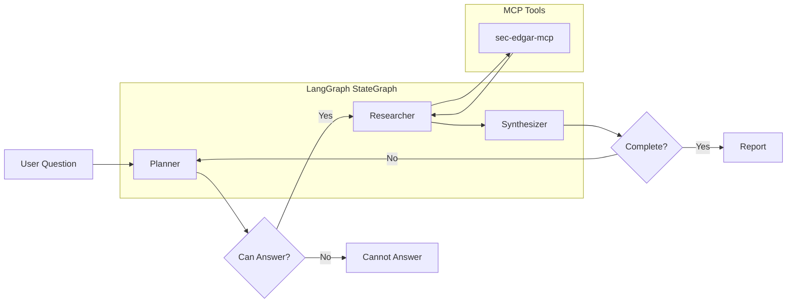

# 10-K Filing Agentic System

A multi-agent research system for SEC 10-K filing analysis using LangGraph and MCP.

## Loom Walkthrough

[Watch the video walkthrough](https://www.loom.com/share/33bc77dec7804b268c563d61ed842866)

## Overview

This system takes questions about SEC 10-K filings, decomposes them into sub-tasks, fetches relevant filing sections via MCP tools, and returns a grounded, citation-backed report.

### Example Results

**Query:** "What are Apple's main risk factors?"

**Response:**
- Global economic conditions - dependence on international sales, recession risks
- Political events & geopolitical tensions - manufacturing in China, India, Taiwan
- Trade restrictions & tariffs - Q2 2025 U.S. tariffs on imports
- Supply chain concentration - natural disasters, climate change

**Query:** "What is Microsoft's cloud revenue?"

**Response:**
- Microsoft Cloud revenue: $214.4 billion (+27% YoY)
- Azure +41%, Microsoft 365 Commercial +17%
- ~65% of total revenue ($331.8B)

**Query:** "Who are the executive officers at Microsoft?"

**Response:**
- Satya Nadella (58) - Chairman and Chief Executive Officer
- Judson B. Althoff (53) - CEO, Microsoft Commercial Business
- Amy L. Coleman (54) - EVP and Chief Human Resources Officer
- Amy E. Hood (54) - EVP and Chief Financial Officer
- Takeshi Numoto (55) - EVP and Chief Marketing Officer
- Bradford L. Smith (67) - Vice Chair and President

### Architecture



**Agents:**
- **Planner**: Parses questions, identifies company ticker, determines which 10-K items are needed
- **Researcher**: Fetches data from SEC EDGAR via MCP tools (sec-edgar-mcp)
- **Synthesizer**: Combines raw data into structured reports with citations

## Quick Start

### Prerequisites

- Python 3.11+ (required for MCP)
- Anthropic API key

### Installation

```bash
# Navigate to project
cd 10k_filing_agentic_system

# Create virtual environment with Python 3.11
python3.11 -m venv venv
source venv/bin/activate

# Install dependencies
pip install -e .

# Install MCP and sec-edgar-mcp
pip install "mcp>=1.0.0"
pip install /path/to/sec-edgar-mcp/  # or: pip install sec-edgar-mcp

# Copy environment file
cp .env.example .env
```

### Configuration

Edit `.env` with your credentials:

```bash
# Required
ANTHROPIC_API_KEY=your_key_here
SEC_EDGAR_USER_AGENT="Your Name (your@email.com)"

# Optional: API Authentication (leave empty for development mode)
API_KEY=your_api_key_here

# Optional: LangSmith tracing
LANGCHAIN_API_KEY=your_langsmith_key
LANGCHAIN_TRACING_V2=true
LANGCHAIN_PROJECT=10k-filing-agent
```

### Running the API

```bash
# Activate venv
source venv/bin/activate

# Start the FastAPI server
uvicorn app.main:app --reload --port 8080
```

### API Usage

**Via Swagger UI:** Go to http://127.0.0.1:8080/docs

**Via curl:**
```bash
# Submit a research question (with API key if configured)
curl -X POST http://localhost:8080/research \
  -H "Content-Type: application/json" \
  -H "X-API-Key: your_api_key_here" \
  -d '{"question": "What are Apple'\''s main risk factors?"}'

# Response: {"job_id": "abc-123", "status": "queued"}

# Check job status
curl -H "X-API-Key: your_api_key_here" http://localhost:8080/jobs/abc-123

# Response: {"job_id": "abc-123", "status": "done", "result": {...}}
```

## API Endpoints

| Endpoint | Method | Description | Auth | Rate Limit |
|----------|--------|-------------|------|------------|
| `/research` | POST | Submit a research question | Yes* | 10/min |
| `/jobs/{job_id}` | GET | Check job status and get results | Yes* | 60/min |
| `/healthz` | GET | Health check | No | None |
| `/cache/stats` | GET | Get cache statistics | Yes* | 30/min |
| `/cache/clear` | POST | Clear the filing cache | Yes* | 5/min |

*Authentication required only if `API_KEY` environment variable is set.

## Security Features

### API Key Authentication

The API supports optional API key authentication via the `X-API-Key` header:

- **Development mode**: If `API_KEY` is not set in `.env`, all requests are allowed
- **Production mode**: Set `API_KEY` in `.env` to require authentication

```bash
# .env
API_KEY=your-secure-api-key-here
```

### Rate Limiting

All endpoints are rate-limited using slowapi to prevent abuse:

- `/research`: 10 requests per minute per IP
- `/jobs/{job_id}`: 60 requests per minute per IP
- `/cache/stats`: 30 requests per minute per IP
- `/cache/clear`: 5 requests per minute per IP

### Input Validation

Request payloads are validated using Pydantic with additional security checks:

- Maximum question length: 1000 characters
- Blocked patterns: SQL injection, prompt injection attempts
- Invalid characters: Control characters, null bytes
- Company ticker validation: Alphanumeric, 1-10 characters

## Reliability Features

### Retry with Exponential Backoff

All SEC EDGAR API calls include automatic retry logic:

- **Max retries**: 3 attempts
- **Base delay**: 1 second
- **Max delay**: 10 seconds
- **Exponential backoff**: 2^attempt seconds

```python
# Example: If first call fails, retries at 1s, 2s, 4s delays
```

### SEC API Rate Limiting

The system respects SEC EDGAR's rate limit of 10 requests per second:

- 100ms delay between consecutive API calls
- Prevents 429 (Too Many Requests) errors
- Automatic backoff on rate limit responses

### Caching

In-memory caching reduces redundant API calls:

- **Filing metadata**: Cached for 1 hour
- **Section content**: Cached for 1 hour
- **Full filing content**: Cached for 1 hour
- **Financial data**: Cached for 1 hour

Cache endpoints:
- `GET /cache/stats` - View cache hit/miss statistics
- `POST /cache/clear` - Clear all cached data

### Parallel Content Fetching

Large filings are fetched in parallel chunks for faster retrieval:

- Initial chunk fetched to determine total size
- Remaining chunks fetched concurrently (4 workers)
- Results combined in order

## Evaluation

Run the evaluation harness against the golden task set:

```bash
source venv/bin/activate
python eval/run_eval.py
```

### Results (5 Golden Tasks)

| Task | Question | Status |
|------|----------|--------|
| 1 | Apple's main risk factors | ✓ |
| 2 | Microsoft's cloud revenue | ✓ |
| 3 | Tesla's business model | ✓ |
| 4 | Amazon's legal proceedings | ✓ |
| 5 | Apple's revenue YoY | ✓ |

## Project Structure

```
10k_filing_agentic_system/
├── app/                    # FastAPI application
│   ├── main.py            # API endpoints with auth & rate limiting
│   ├── models.py          # Pydantic schemas with validation
│   └── config.py          # Settings
├── agents/                 # LangGraph agents
│   ├── state.py           # ResearchState definition
│   ├── planner.py         # Planner agent (expanded item detection)
│   ├── researcher.py      # Researcher agent (MCP + retry + caching)
│   ├── synthesizer.py     # Synthesizer agent
│   └── graph.py           # StateGraph with conditional edges
├── tools/                  # Tool integrations
│   ├── sec_client.py      # Direct SEC API fallback
│   ├── section_extractor.py  # Full 10-K section parser
│   └── cache.py           # In-memory TTL cache
├── eval/                   # Evaluation
│   ├── golden_tasks.json  # Test questions with fact-checking
│   └── run_eval.py        # Evaluation script with LLM-as-judge
├── traces/                 # LangSmith trace screenshots
├── Dockerfile
├── docker-compose.yml
└── pyproject.toml
```

## Requirements Checklist

| # | Requirement | Status |
|---|-------------|--------|
| 1 | LangGraph with 3+ agents | ✅ Planner, Researcher, Synthesizer |
| 2 | StateGraph with conditional edge | ✅ 2 conditional edges |
| 3 | At least one MCP-backed tool | ✅ sec-edgar-mcp |
| 4 | FastAPI service | ✅ POST /research, GET /jobs, GET /healthz |
| 5 | Pydantic schemas | ✅ Request/response models |
| 6 | Async endpoint | ✅ /research is async |
| 7 | LangSmith tracing | ✅ Configured via env vars |
| 8 | Golden task set (5+) | ✅ 5 SEC filing questions |
| 9 | Eval harness | ✅ run_eval.py |
| 10 | Dockerfile | ✅ Containerized |
| 11 | CLAUDE_CODE_NOTES.md | ✅ Documented |

## MCP Integration

This project uses **sec-edgar-mcp** to fetch SEC filing data. The MCP tools are called directly from the Researcher agent:

```python
from sec_edgar_mcp.tools import FilingsTools, FinancialTools

filings_tools = FilingsTools()
financial_tools = FinancialTools()

# Get recent 10-K filings
filings = filings_tools.get_recent_filings("AAPL", "10-K", 365, 1)

# Extract filing sections (business, risk_factors, mda)
sections = filings_tools.get_filing_sections("AAPL", accession_number, "10-K")

# Get financial statements
financials = financial_tools.get_financials("AAPL", "all")
```

### Enhanced Section Extraction

The MCP tool only extracts 3 sections with 10k char limits. For complete data, we added a custom `section_extractor.py` that:

1. Fetches full filing content via `get_filing_content()`
2. Parses all 16 standard 10-K items
3. Extracts subsections (e.g., "Executive Officers" within Item 1)
4. Distinguishes TOC entries from actual content

**Supported Items:**
- Part I: Items 1, 1A, 1B, 1C, 2, 3, 4
- Part II: Items 5, 6, 7, 7A, 8, 9, 9A, 9B, 9C
- Part III: Items 10, 11, 12, 13, 14
- Part IV: Items 15, 16

---

## Production Readiness Guide

This section documents what has been implemented and what additional work is needed for a production deployment.

### ✅ Implemented

| Feature | Description | Location |
|---------|-------------|----------|
| API Key Authentication | Optional auth via `X-API-Key` header | `app/main.py` |
| Rate Limiting | Per-IP rate limits on all endpoints | `app/main.py` |
| Retry with Backoff | Exponential backoff for SEC API calls | `agents/researcher.py` |
| SEC Rate Limiting | 100ms delay between API calls | `agents/researcher.py` |
| Input Validation | Pydantic validators for security | `app/models.py` |
| In-Memory Caching | TTL-based cache for filings | `tools/cache.py` |
| Parallel Fetching | Concurrent chunk fetching | `agents/researcher.py` |
| LangSmith Tracing | Observability for agent runs | Environment config |

### 🔲 Recommended for Production

#### 1. Redis for Job Store and Cache

Replace in-memory storage with Redis for:
- **Job persistence**: Jobs survive server restarts
- **Horizontal scaling**: Multiple API instances share state
- **Cache sharing**: Reduce redundant SEC API calls across instances

```python
# Example Redis integration
import redis
from redis import Redis

redis_client = Redis.from_url(os.getenv("REDIS_URL", "redis://localhost:6379"))

# Job storage
def save_job(job_id: str, job_data: dict):
    redis_client.setex(f"job:{job_id}", 3600, json.dumps(job_data))

# Cache
def get_cached_filing(key: str) -> Optional[str]:
    return redis_client.get(f"cache:{key}")
```

#### 2. Database for Job History

For audit trails and analytics:
- PostgreSQL or similar for job history
- Track: job_id, question, status, result, created_at, completed_at
- Enable querying past research results

#### 3. Secrets Management

Move from `.env` files to proper secrets management:
- **AWS**: Secrets Manager or Parameter Store
- **GCP**: Secret Manager
- **Azure**: Key Vault
- **Kubernetes**: External Secrets Operator

```python
# Example: AWS Secrets Manager
import boto3

def get_secret(secret_name: str) -> str:
    client = boto3.client('secretsmanager')
    response = client.get_secret_value(SecretId=secret_name)
    return response['SecretString']
```

#### 4. Structured Logging

Replace print statements with structured logging:

```python
import structlog

logger = structlog.get_logger()

logger.info("research_started", 
    job_id=job_id, 
    company=company,
    items_needed=items_needed
)
```

#### 5. Health Check Enhancements

Add dependency health checks:

```python
@app.get("/healthz")
async def health_check():
    checks = {
        "api": "healthy",
        "redis": check_redis_connection(),
        "sec_api": check_sec_api_reachable(),
    }
    status = "healthy" if all(v == "healthy" for v in checks.values()) else "degraded"
    return {"status": status, "checks": checks}
```

#### 6. Metrics and Monitoring

Add Prometheus metrics:

```python
from prometheus_client import Counter, Histogram

research_requests = Counter('research_requests_total', 'Total research requests')
research_duration = Histogram('research_duration_seconds', 'Research job duration')
cache_hits = Counter('cache_hits_total', 'Cache hit count', ['cache_type'])
```

#### 7. Request Tracing

Add distributed tracing with OpenTelemetry:

```python
from opentelemetry import trace
from opentelemetry.instrumentation.fastapi import FastAPIInstrumentor

FastAPIInstrumentor.instrument_app(app)
```

#### 8. Graceful Shutdown

Handle in-flight requests during deployment:

```python
@app.on_event("shutdown")
async def shutdown_event():
    # Wait for background tasks to complete
    # Close database connections
    # Flush metrics
    pass
```

### 🔲 Optional Enhancements

| Feature | Description | Priority |
|---------|-------------|----------|
| WebSocket support | Real-time job status updates | Medium |
| Batch API | Process multiple questions | Medium |
| Historical comparison | Compare filings across years | Low |
| Other SEC forms | Support 10-Q, 8-K, etc. | Low |
| PDF export | Generate PDF reports | Low |
| User accounts | Multi-tenant support | Low |

### Deployment Checklist

Before deploying to production:

- [ ] Set `API_KEY` environment variable
- [ ] Configure Redis URL (if using Redis)
- [ ] Set up monitoring/alerting
- [ ] Configure log aggregation
- [ ] Set appropriate rate limits for your use case
- [ ] Review and adjust cache TTLs
- [ ] Set up SSL/TLS termination
- [ ] Configure CORS if needed
- [ ] Set up backup/recovery procedures
- [ ] Document runbooks for common issues

---

## License

MIT
